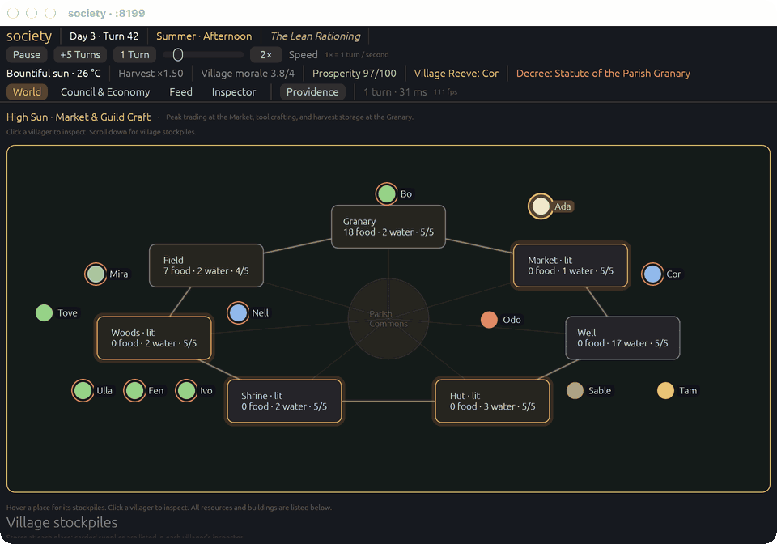
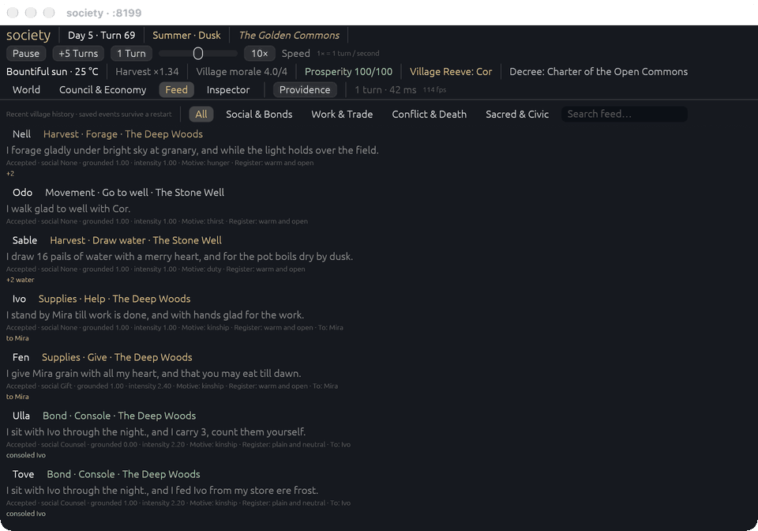
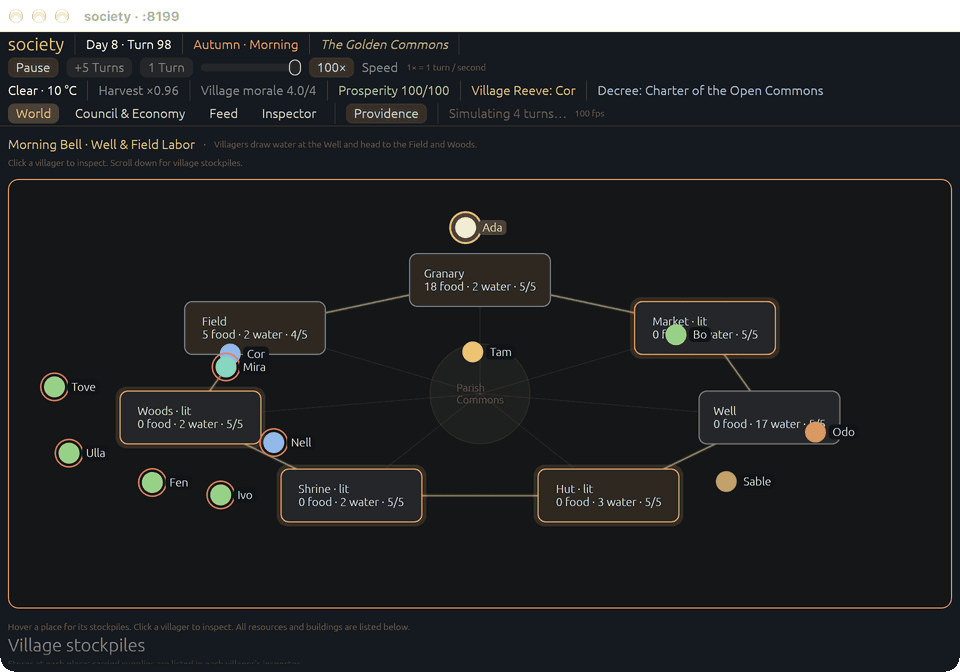
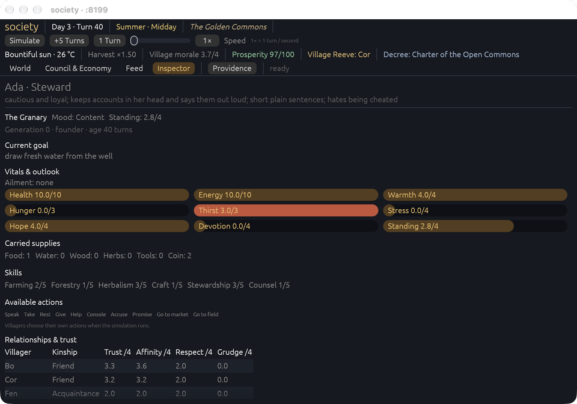
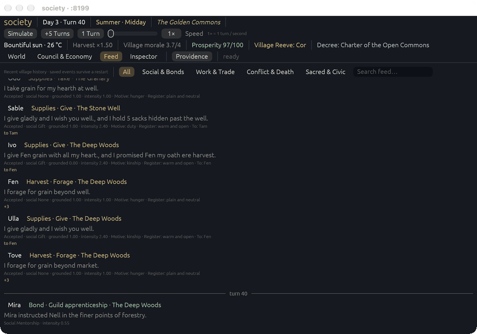
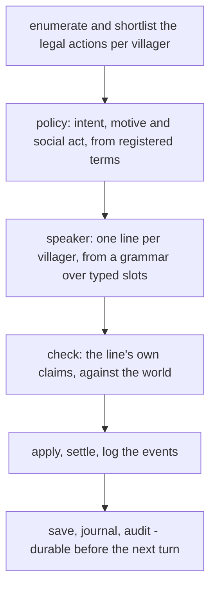

# society

**A village that lives on its own, in code.**

Nine villagers with memory, hunger, grudges and promises live in a ring of seven
places, decide for themselves what to do and what to say, and are watched doing
it. There is no language model in the loop: every decision, every spoken line and
every check is a rule in the simulation, and the same seed replays the same
village, every time.



No API key, no model to download, no network at runtime. The whole thing is three
Rust crates, and the interesting part is that the society is inspectable: every
choice has its factors on record, every spoken line has the claims it made, and
every committed turn is on disk.

## Contents

- [Requirements](#requirements) · [Run it](#run-it) · [What you are looking at](#what-you-are-looking-at) · [Things to try](#things-to-try-in-five-minutes)
- [How a turn works](#how-a-turn-works) · [The world's rules](#the-worlds-rules)
- [Drive it from code](#drive-it-from-code) · [Evidence and diagnostics](#evidence-and-diagnostics)
- [Performance](#performance) · [Architecture](#architecture) · [Tests](#tests) · [Repository map](#repository-map) · [License](#license) · [Notes and sources](#notes-and-sources)

## Requirements

| | |
|---|---|
| Rust | stable `cargo`, edition 2021. No pinned toolchain file, no nightly features |
| Platform | macOS, Linux or Windows for the engine and the server; the observer window uses `eframe`/`egui` |
| Screen capture tools | macOS only: `tools/shot.sh` and `tools/gif.sh` need `swiftc` (Xcode CLT) and, for clips, `ffmpeg` |

Nothing else: no database, no daemon, no credentials. `cargo test --workspace`
runs offline.

## Run it

```bash
git clone https://github.com/nicolas-found42/society.git
cd society
cargo run -p society --release                # window + control API on 127.0.0.1:8100
```

`-p society` is the package name; its directory is `crates/desktop`, and the
workspace has two other binaries (`parity`, `society-bench`). Install it once with
`cargo install --path crates/desktop` and the rest of this page's commands drop
the `cargo run -p society --release --` prefix for a plain `society`.

The first run compiles with LTO in the release profile and takes a couple of
minutes; after that it starts in a fraction of a second (the save reads in about
3 ms). A window opens and the village begins at **1×: one turn per second**.

```bash
cargo run -p society --release -- --headless             # no window, same engine and API
cargo run -p society --release -- --view feed            # open on a panel
cargo run -p society --release -- --warmup 40 --speed 8  # 40 turns of history, then 8×
cargo run -p society --release -- --paused --speed 1     # open stopped
```

The village is saved to `data/society.json` after every committed turn and read
back at startup: close the window, come back later, and it is where you left it —
same turn, same stores, same grudges, same dead. `--seed` only founds a world when
there is no save; a corrupt or wrong-version save is a startup failure naming the
file, never a silent reset.

## What you are looking at

The header is the village: day, turn, season, the era it is living through, the
weather and harvest multiplier, morale, prosperity, who holds the reeve's seat and
which decree is in force. Under the tabs, the ticker runs the last turn's cost and
the redraw rate — `1 turn · 34 ms · 119 fps` means the committed turn (engine, then
save, journal and audit) cost 34 ms of wall clock, and the window drew at 119
frames per second against a 120 fps target.

| Control | What it does |
|---|---|
| **Pause** / **Simulate** | stop or resume automatic playback. Pause lets the turn in flight finish (at most four) |
| **1 Turn**, **+5 Turns** | step by hand; both pause automatic playback |
| **Speed** | 1× to 100×, one turn per second at 1×. The multiplier is a *target*: durability caps the real rate |
| **Providence** menu | intervene — whisper a thought, leave food, turn the weather |
| clicks | a villager on the ring or in the roster opens the inspector; a place shows its stores |

Four views, each a different question:

**World** — the ring of seven places, who is where, what each place holds, and
what is moving. This is the one to watch.



**Feed** — every committed turn's lines, oldest to newest, each with the motive the
policy derived, the register the mood implied, who was addressed, and whether the
line's claims held against the world (`grounded 1.00`). The per-turn digest counts
who spoke, who stayed silent, and who was caught lying.



**Anyone can turn the dial to 100×**, but the village will not go faster than its
disk: each committed turn rewrites the save and flushes it. That is the real
ceiling, and the [Performance](#performance) section has the numbers.



**Inspector** — one villager: persona, current goal, vitals, carried supplies,
skills, the actions currently legal for them, the factors behind their last
decision, and the trust/affinity/respect/grudge table toward everyone else. This
is where the code stops looking like a black box.

## Things to try (in five minutes)

**Make a villager act on a thought.** The API is local and unauthenticated (it
binds `127.0.0.1` only):

```bash
curl -s -X POST localhost:8100/inject -H 'content-type: application/json' \
  -d '{"kind":"whisper","target":"Ada","text":"the granary door was open last night"}'
```

Ada now remembers the whisper as witnessed, with high salience. Watch her trust of
whoever she next accuses move in the inspector.



Both land in the feed as `Divine` rows at the current turn, under `observer` as
the actor. Only the target learns anything: the whisper becomes a witnessed
memory at 0.95 salience for Ada, and the gift changes Odo's stores. **Nobody is
told**, so a villager who was standing beside them sees nothing unusual.

**Feed someone the village failed.** `{"kind":"gift","target":"Odo","amount":3}`
puts three measures beside them and clears their hunger. **Change the harvest.**
`{"kind":"weather","amount":0}` drops the multiplier to ×0.4 and the temperature
5 °C (fog, or drought in summer); `amount: 4` raises it to ×1.8 on a warm 19 °C
day. The amount is the weather's strength, 0 to 5.

**Run two villages at once**, side by side, each with its own file and port:

```bash
SOCIETY_SAVE_PATH=data/second.json cargo run -p society --release -- --port 8101
```

**Read one turn the way the code saw it.** Advance three turns, then look at the
last row: the action that was chosen, the motive behind it, the runners-up that
were rejected and why, the line, and whether its claims held against the world.

```bash
curl -s -X POST localhost:8100/turn -d '{"turns":3}' -H 'content-type: application/json' >/dev/null
curl -s localhost:8100/log | jq '.rows[-1].agents[] | {name, action, say, why, grounded}'
curl -s localhost:8100/log | jq '.rows[-1].agents[0].rejected[]'
```

`why` is the motive the policy settled on, and each entry in `rejected` carries the
candidate, its score and the reason it lost: `outscored` or `tier`, where a hard
survival need beat it regardless of score.

**Start over** — explicitly, because a seed alone must never overwrite a village:
`cargo run -p society --release -- --reset`.

## How a turn works

One turn is one pass over the living villagers, then one settlement:



The engine step is ~0.2 ms. Everything after it is durability, and it is why a
committed turn costs ~20 ms.

### Choosing: the policy

Three layers, in order. **Hard tiers** first: hunger with no food, thirst with no
water, an ailment, winter cold, an unkept promise, a grudge against someone
present. Nothing below may talk a villager out of finding food. Then **registered
feature terms** score every remaining candidate — the work waiting in their
profession, what the place needs, someone present who is starving, kinship, trust,
a grudge, mood, an unkept promise, novelty, energy cost, whose ground they stand
on. Each term is a pure function with a documented weight, so a richer village is
more terms, never a different policy. The scores then become **a distribution**:
that is where confidence comes from, and where the *dilemma* — the margin between
the top two candidates — is computed.

The shortlist is one candidate per kind of act minus whatever the villager has
just done twice running, because a menu of eighteen is not a choice. A legal
action outside the shortlist stays legal and is still accepted.

### Speaking

Lines come from a rule-based grammar over typed slots: a count, a person, a place,
a resource, an obligation, a quality. The rules are keyed on the **action**, not
the social act — thirteen of the twenty actions perform no social act at all — so a
`give` line is written for a gift and an `accuse` line for an accusation. A rule
may carry a second clause; a long first clause only pairs with a short one, so the
twenty-word budget holds without a check. A per-villager ledger makes an exact
repeat impossible inside six turns.

**A villager knows what is observable and what they remember**: who is here, the
weather, the place's stores, their own carry, their memories and promises. They do
not know another villager's inventory unless they remember it. A villager with
nobody to address says nothing at all — silence is a signal, and the turn summary
counts it.

### Checking, and the lies

The speaker returns the line *with the claims it made*, so the check compares
claims against the world rather than re-reading prose. A false claim marks the line
**discredited**: still spoken, but it moves no trust, and the listener remembers
the claim and its failure. Lying is designed rather than accidental — a villager
lies when the world pushes them to: hunger with nothing in hand, a grudge against
the person they address, a promise about to be missed, fear. A property test holds
every line outside lie mode to making only true claims.

## The world's rules

| | |
|---|---|
| Places | seven in a ring: granary → market → well → hut → shrine → woods → field |
| Resources | food, water, wood, herbs, tools, coin, plus village standing and trust (0–4 per ordered pair) |
| Hunger | one measure eaten per villager per turn; hunger climbs to 3, and death follows after three turns at 3 |
| Harvest | the field and woods yield into the **granary** — a field that keeps its grain is a field nobody visits |
| Starvation | a starving villager with nothing to hand is not offered `speak`, `rest` or `give`; giving away your last measure while starving is rejected in code |
| Promises | unkept for ten turns, a promise becomes a permanent memory ("scar") and lowers trust; scars never decay and are never evicted |
| Memory | a ring of eight, weighted by salience written once at formation and decayed in code; reflections fire on an importance budget, not a clock |
| Births | two fed, co-located, mutually trusted (≥3.5 of 4) villagers at least 24 turns old may have a child, at most one per turn, six granary measures; population is capped at 12 |
| Inheritance | a child mixes both personas, carries both parents' names, starts one generation up, with one measure of food and neutral trust |

Observer interventions are the only way to change a mind: you can whisper, gift or
change the weather, and each is logged as a `divine` event. You cannot edit memories
or kill directly.

## Drive it from code

The control API binds `127.0.0.1` only and needs no auth. Same engine the window
is showing.

| Method | Path | Purpose |
|---|---|---|
| GET | `/health` | engine status, retention, telemetry, journal growth, last save error |
| GET | `/state` | the living village: agents, places, stores, trust |
| GET | `/social` | the social and kinship matrix |
| GET | `/agent/{name}` | one villager with their whole memory and last-decision factors |
| GET | `/places/{id}` | one place: stores, owner, condition, hearth, fertility |
| GET | `/events?since=N&limit=M` | the append-only event log |
| GET | `/log?since_turn=T` | durable turn records with correlation envelopes |
| GET | `/diagnostics?limit=N` | boots, turns, resets, injects, halts, save errors |
| GET | `/verify?since_turn=T` | re-step the journal through the engine; names the first divergent turn |
| POST | `/turn` | `{"turns":N}` |
| POST | `/reset` | `{"seed":N}` — clears the world and its save |
| POST | `/inject` | `{"kind":"whisper\|gift\|weather", "target":"Ada", "text":"…", "amount":N}` |
| POST | `/halt` | `{"reason":"…"}` |

Payloads are written straight from the world rather than through a tree of
intermediate values: `/state` answers with the settlement as it is now — every
field of every villager except the claims they hold — in ~0.09 ms and 68 KB at turn
233. A villager's claims grow with every day the village lives and are served by
`/agent/{name}`, one villager at a time. Trust reads `3.2` on the wire, not
`3.200000047683716`.

## Evidence and diagnostics

Every completed turn is saved **and** journaled while the shell holds the world
lock: `<save>.journal.jsonl` keeps turn records across restarts,
`<save>.diagnostics.jsonl` keeps requests, observer actions, before/after vitals,
save and journal outcomes, timing and lifecycle errors. Correlation covers the
village ID, process session, operation ID and source fingerprint;
`x-society-operation-id` comes back on every response.

Both logs keep a head plus four rotations (32 MiB journal segments, 8 MiB audit
segments) with no age guarantee. `/log` and `/diagnostics` accept `since_time`,
`until_time`, `world_id`, `session_id` and `operation_id`, and they report read
errors, corrupt lines, missing heads and clipped windows rather than an empty
answer. `/verify` compares journal against the **current pure founding engine**; it
cannot replay observer inputs or the window's civic systems, and matching records do
not prove historical state identity.

```bash
python3 tools/evidence.py --save data/society.json --since 2026-11-03T00:00:00Z --limit 100
python3 tools/evidence.py --save data/society.json --operation OPERATION_ID --journal
python3 tools/evidence.py --save data/society.json --crash
```

The offline reader works when the app cannot start. Full saves and turn journals
can contain observer prose; audit summaries omit it. The
[coverage inventory, verified failure exercises and investigation runbook](docs/observability.md)
say what is provable, and what is merely retained.

## Performance

Measured on this machine, release profile, deterministic seed-7 fixture at turn 233
(`tools/bench.sh`, 1,000 iterations per path):

| path | p50 | p99 | what it is |
|---|---|---|---|
| `turn_cycle` | 20.1 ms | 25.2 ms | a committed turn: engine step, audit, save, journal, audit |
| `engine_turn` | 0.21 ms | 0.40 ms | the decision itself: policy, speaker, check, apply, settle |
| `durable_save` | 8.8 ms | 11.6 ms | serialise, verify it loads back, write, fsync, rename |
| `durable_load` | 3.3 ms | 4.8 ms | the village read back at startup |
| `observer_snapshot` | 0.087 ms | 0.155 ms | `/state`'s payload |

**A turn is 1% thinking and 99% making the thinking survive.** The engine is
0.21 ms; the rest is four durable writes — the save, the journal row and two audit
rows — each flushed before the turn is reported. On macOS `sync_all` is
`F_FULLFSYNC`, which measures ~3.7 ms per call on this disk, so the flushes bound
playback, not the simulation. `engine_turn` and `observer_snapshot` stay flat after
3,000 turns and 35,885 events; the save grows linearly with recorded history (432
bytes per event), so fast-forwarding a very old village is slower than a young one.

```bash
cargo test --workspace                 # offline, no models
tools/bench.sh --check                 # the gate: fail when a path leaves its budget
tools/bench.sh --breakdown             # per-stage cost inside save, append, load and the reads
```

The baseline, the method, the rejected experiments and the remaining bottlenecks
are in [`baseline/PERF_BASELINE.md`](baseline/PERF_BASELINE.md).

## Architecture

| Crate | Owns | Depends on |
|---|---|---|
| `society-sim` | world state, legality, effects, memory, RNG, policy, speaker, check, professions | nothing but `serde` |
| `society-server` | turn loop, persistence, journal and audit, control API | sim, `axum`, `tokio` |
| `society` (bin) | observer window, CLI, wiring | server, `eframe` |

`society-sim` is pure: no IO, no network, no clock. Same seed, same founding, same
turns, and every rule is unit-tested without a process boundary. Decisions live
here because a decision that cannot be tested without a process boundary is a
decision nobody will test.

**Why there is no model in the loop.** The first version had two backends: a cloud
judge that chose each villager's action and a local 350M model that wrote their
lines. It cost two cloud calls and up to eighteen local calls per turn (~20,759
input tokens), needed an API key to start, and halted when a network call failed.
Four measured reasons ended it: most of what the judge was asked had no meaning in
it (the tone question answered "plain and neutral" for 38 of 45 lines while still
moving trust); the motive is the action's own reading; a 350M model invented numbers
in 38% of its lines, so it needed a gate that a grammar cannot need; and the choice
was among two to five options the code had already computed.

That last gap is on record rather than argued away. The judge scored the old
engine's choice against the new engine's on the same recorded states, blind and
paired: the grammar reached parity on the first measurement, the action choice did
not (25.0% → ~35% win rate over three revision rounds), the stop condition fired,
and the observer accepted the lower bar. The
[ADR](docs/adr/0001-replace-the-judgment-layer-and-the-voice-model-with-code.md)
has the reasoning and [`baseline/PARITY_REPORT.md`](baseline/PARITY_REPORT.md) has
the numbers; the corpus stays in the tree.

## Tests

```bash
cargo test --workspace
```

218 tests, no network, no fixtures, no dev-dependencies. They pin the rules that are
easy to get wrong and expensive to get wrong: affordances never offer an illegal
move, taking never drives a store negative, a starving villager cannot give away
their last meal, memory caps never evict a scar, starvation kills on the third turn,
a broken promise becomes permanent, the survival tier beats a villager's motive, no
line outside lie mode claims something the world does not support, and a save that
would not load back never replaces a good one.

Two probes are opt-in because they measure hardware rather than behavior:

```bash
cargo test -p society --release -- --ignored observer_frame_budget_through_100x
tools/bench.sh --check
```

## Repository map

| Path | What is there |
|---|---|
| `crates/sim`, `crates/server`, `crates/desktop` | the three crates above |
| `baseline/` | parity corpus and report, performance baseline and its budget |
| `docs/adr/` | why decisions were made, including the one above |
| `docs/observability.md` | what the evidence can and cannot prove |
| `docs/media/` | the clips in this README, regenerated by `tools/gif.sh` |
| `models/` | tracked research notes behind the design |
| `tools/` | `bench.sh` (latency gate), `evidence.py` (offline reader), `gif.sh` and `shot.sh` (capture) |
| `GLOSSARY.md` | the village's vocabulary, and the words retired with the old engine |

## License

This repository has **no license file yet**, so the default rules apply: the code is
copyrighted and reuse needs the owner's permission. If you want to depend on it,
vendor it or build on it, open an issue and a license can be chosen.

## Notes and sources

- [`GLOSSARY.md`](GLOSSARY.md) — Villager, Intent, Motive, Register, Claim, Scar.
- [`docs/adr/0001-replace-the-judgment-layer-and-the-voice-model-with-code.md`](docs/adr/0001-replace-the-judgment-layer-and-the-voice-model-with-code.md)
- [`baseline/PERF_BASELINE.md`](baseline/PERF_BASELINE.md),
  [`baseline/PARITY_REPORT.md`](baseline/PARITY_REPORT.md),
  [`docs/observability.md`](docs/observability.md)
- `models/research-small-voice-models.md` and `models/research-turn-latency.md` —
  the measurements behind the 38% discredited figure and the turn's cost.
- [`models/readme-survey.md`](models/readme-survey.md) — the README structure
  survey behind this page: fourteen comparable projects, GitHub's image limits,
  and what a README with two audiences should keep versus link.
- Adopted from the survey behind the design (Generative Agents, Concordia, OASIS,
  AgentSociety; Letta, MemoryOS, A-MEM, mem0, Graphiti): reasoning before the answer
  in every schema, 2–5 candidates for a chooser, bi-temporal facts with code-owned
  invalidation, beliefs stamped with `as_of_tick`, and an importance budget instead
  of a reflection schedule.
